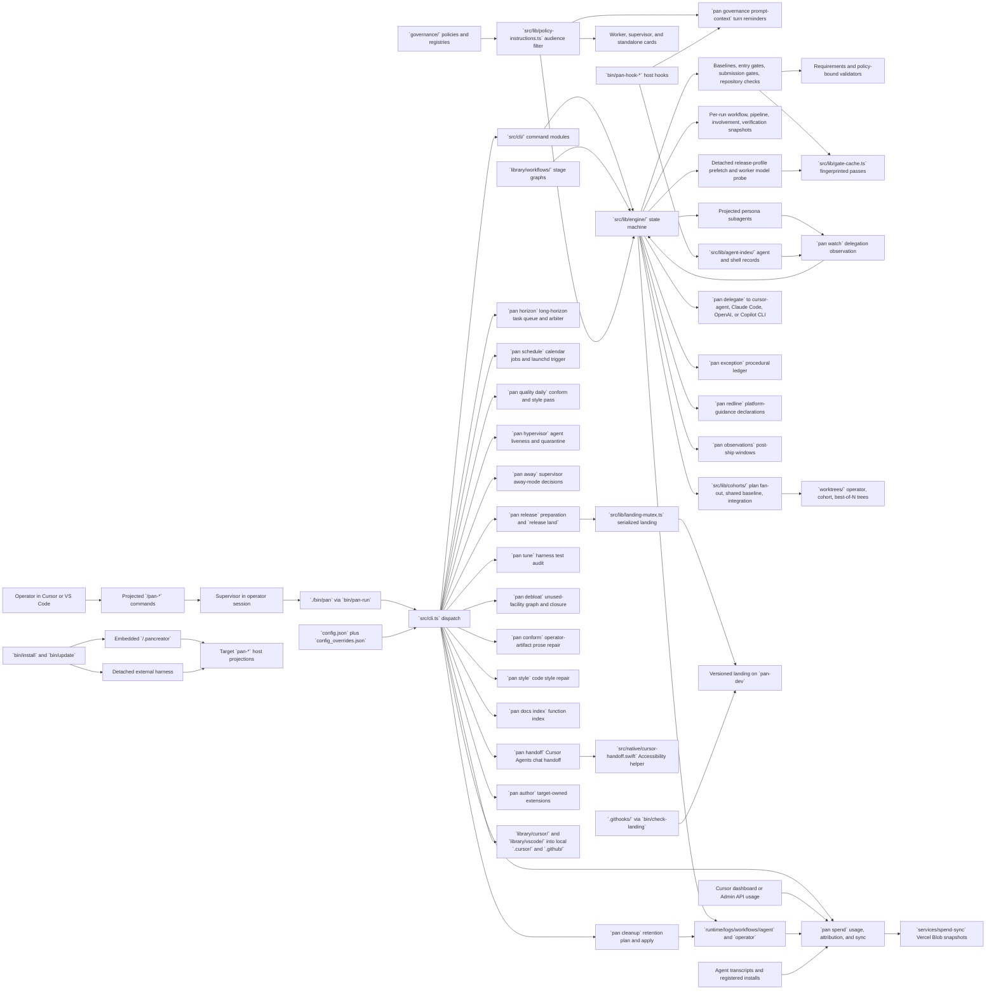

# Target repository primer

<!-- pancreator-primer-status: ready -->
<!-- generated-at: 2026-10-21T04:40:00Z -->
<!-- source-head: 64cc2e59c945356d9064f20d25d79fd3b73d35e5 -->

**Freshness:** `pan validate` and `pan doctor` report when this primer's `source-head` differs from the checkout; run `/pan-build-docs` to refresh it.

## Summary

Pancreator is an agentic workflow harness written in strict TypeScript and Bash. A host editor supplies model execution and MCP access; the dependency-free Node.js CLI owns workflow snapshots, state transitions, deterministic gates, retries, validation evidence, and audit records. This checkout is the self-development source (`config.json.installation_mode: self_development`, version `9.10.0`). Cursor remains the primary host, and `config.json.hosts` also enables VS Code with GitHub Copilot, so personas, commands, rules, and hooks project into both `.cursor/` and `.github/`. `library/` is canonical for workflows, personas, skills, host projections, schemas, and templates; `governance/` holds policies, registries, criteria, and durable handbooks; `runtime/` holds generated run state and evidence; `worktrees/` holds operator, cohort, and best-of-N checkouts; `services/spend-sync/` is the one deployed service. `/pan-start` and `/pan-resume` adopt the supervisor brief in the operator's session and advance one run at a time; `/pan-cohort` supervises a fan-out of chunk runs and `/pan-horizon` supervises a queue of tasks across a long absence. The supervisor delegates each worker stage to a named persona subagent, or to an external executor when the persona mapping carries a `cursor-cli:`, `claude-code:`, `openai:`, or `copilot:` prefix; `pan delegate --headless` dispatches a Cursor-executor stage through the harness's own `cursor-agent` path when the platform exposes no projected agent. `planning` is the default workflow and the entry point for delivery work: it runs one `plan` stage behind one operator gate, and approving that gate routes the work automatically into either one `delivery` run or a cohort of parallel `delivery-chunk` runs followed by one release run. Each run snapshots its own workflow graph, persona-model mapping, operator-involvement profile, review mode, and verification level at creation, so later configuration edits never change a run in flight. A run also renders a supervisor governance card that the supervisor must attest, and the supervisor must observe every delegated worker through `pan watch` before the harness accepts a submission. Deterministic verification is tiered: one shared `static` and `fast` baseline is captured per unit of work, agents iterate on the `impacted` profile, `impacted-integration` gates the integration lane at implement and remediate, and `impacted-release` is the release gate that replaced `full` for a self-development land. The harness keeps that work off the supervisor's critical path: a run adopts a recorded passing baseline taken at the same workspace fingerprint and verification-configuration digest, an agent's own clean profile pass is stored where the submit gate already looks, a source stage that submits into a read-only evidence stage starts a detached low-priority prefetch of the ship release profile, and a worker model probe records a `pending` marker and answers from a detached child instead of blocking the launch. Governance reaches agents through audience-filtered instruction delivery rather than whole policy bodies: every instruction carries an audience, a worker card, a supervisor card, and the harness-only audit snapshot each receive only what is written for them, delegated procedures point at per-policy section digests, and host hooks inject scoped turn reminders from `governance/registries/turn_reminder_profiles.json` on each tool cycle. Accountability subsystems record what the harness cannot infer: `pan exception` keeps the procedural exception ledger, `pan redline` records platform-guidance declarations and sightings, `pan observations` tracks post-ship observation windows, and the agent-index hooks register every launched agent and shell record. Optional `pan hypervisor`, `pan away`, `pan horizon`, and `pan schedule` subsystems add agent liveness checks and quarantine, supervisor-decided unattended continuation, long-horizon task queues, and calendar triggers; away mode is disabled in `config.json`, and the one scheduled job `daily-quality` is itself disabled. Standalone command-backed modes cover authoring target extensions (`pan author`), auditing the harness test suite (`pan tune`), removing unused harness facilities (`pan debloat`), local release preparation and landing (`pan release`), Simplified Technical English repair of operator-timed prose (`pan conform`), judgment-level code style repair (`pan style`), report-first retention cleanup (`pan cleanup`), Cursor token spend reporting (`pan spend`), and supervision handoff to a fresh chat (`pan handoff`). `bin/install` packages the harness into another repository in embedded or detached mode while leaving that target the owner of application source, tracked files, existing agentic tooling, and Git state. The harness test suite is self-development-only and is not part of an installed payload. Repository validation is installation-scoped for the same reason: the audits that describe Pancreator's own source authoring run only when `config.json.installation_mode` is `self_development`, so a fresh embedded install reports zero validation errors and zero warnings.

## Administrative commands

### Install

- Node.js 22 or newer, npm, and Git are required; `package.json` declares `engines.node >= 22.0.0`. Cursor needs project commands and subagents enabled; VS Code needs Copilot agent mode. An external executor is needed only when a persona mapping routes to it: the Claude Code CLI for `claude-code:`, `OPENAI_API_KEY` for `openai:`, and the GitHub Copilot CLI 1.0.88 or later for `copilot:`. `pan spend` needs `CURSOR_SESSION_TOKEN` for personal usage or an `admin:*`-scoped `CURSOR_ADMIN_API_KEY` for team usage, and `pan spend sync|report` additionally needs `PAN_SPEND_SYNC_TOKEN` with `config.json.spend.vercel_host`.
- `npm ci` installs the locked development toolchain (TypeScript, Node types, Prettier). The harness has no runtime dependencies. It is also the workspace bootstrap recorded in the `setup` array of `runtime/repository-checks.json`, because a fresh worktree carries no installed dependencies.
- `npm run prepare` points `core.hooksPath` at `.githooks/`, which holds `pre-commit` and `pre-merge-commit`. Both call `bin/check-landing`, which refuses a direct installable commit on `pan-dev` or `main` and a merge whose source branch carries no new indexed release. `bin/check-landing branch <ref> [<base-ref>]` reports landability without committing, and `bin/check-landing daily-range <base> <head>` accepts marked daily-quality commits over surface paths only.
- `./bin/pan models --sync` renders canonical assets and the active model mapping into the ignored local `.cursor/` tree and, when `hosts` names `vscode`, into `.github/` and `.agents/`. Run it after cloning and after any `active_config` or mapped-model change. `--force` with `--sync` projects the configured specs when the local Cursor model catalog is stale or incomplete.
- `./bin/install --target /path/to/target-repository` builds an embedded harness at `<target>/.pancreator`; add `--harness-dir /outside/path` for a detached installation, which must sit outside the target tree.
- `--yes`, `--repair`, `--clean`, and `--smoke` provide idempotent refresh, in-place repair, full reinstall, and the deterministic installer smoke harness. Installation writes the target's clone-local `.git/info/exclude` and never modifies a target-tracked file or the target `.gitignore`.
- The installed payload excludes `tests/` and `dist/tests/`, strips `tests/` from the staged `tsconfig.json`, and `bin/install-support strip-harness-test-scripts` removes every `test` and `test:*` script from the staged `package.json`. `tests` is a retired payload entry (`RETIRED_PAYLOAD_ENTRIES`): a refresh from an older installation deletes only the files whose recorded release digest still matches, backs up and retains anything changed or target-added, and reports both sets.
- Installation also appends a guarded `pan` shell function to the operator's Bash and Zsh rc files. `--skip-shell-alias` suppresses that step, and the installer smoke harness always passes it.
- `./bin/update --target /path/to/target-repository [--harness-dir /outside/path] [--skip-shell-alias]` fast-forwards an installation from an indexed release.
- `./bin/vscode-customizations --check|--apply` installs the captured VS Code customizations (model-picker provider sections, BYOK recovery, default model resolution, effort levels, governance patches). It changes the selected VS Code app and every existing user profile across all workspaces, and neither installation nor projection ever applies it automatically.

### Build

- `npm run build` calls `./bin/run-built --build-only`, which serializes builds on a per-root lock and delegates to `bin/build`. `bin/build` compares a fingerprint stamp of `tsconfig.json`, `package.json`, `package-lock.json`, and every `src/` and `tests/` TypeScript file against `dist/.build-stamp`, and rebuilds by removing `dist/` and running `tsc` only when the stamp is stale.
- A stale stamp compiles into a private `dist.build-<pid>` staging directory and swaps it into place with two renames, so `dist/` is never absent or half-written and a build never waits for a running consumer. A long-lived `pan watch` therefore cannot delay a build on its root.
- `./bin/build --stamp-fresh` reports whether `dist/` already matches its inputs, and `npm run typecheck` runs `tsc --noEmit`.
- Every `./bin/pan ...` invocation goes through `bin/run-built`, which builds when needed under a per-root lock held only for the compile, and then dispatches `dist/src/cli.js`. A caller that waits more than `PANCREATOR_BUILD_LOCK_NOTICE_SECONDS` (default 5) for that lock prints one notice naming the holder pid. `bin/openai` dispatches `dist/src/openai-cli.js` and `bin/vscode-customizations` dispatches `dist/src/vscode-customizations.js` the same way.

### Test

- `npm test` is the documented default suite: it builds, then runs `node --test` over the compiled `unit` and `regression` lanes only. The integration lane was removed from the default command and now runs through the `impacted-integration` gate and through `npm run test:coverage`. Every test script routes through `bin/run-tests` and the compiled `tests/reporters/failures-only.ts` reporter, so a passing run prints almost nothing. The lanes currently hold 153 unit, 235 integration, 53 regression, and 10 secondary test files.
- `npm run test:unit`, `npm run test:integration`, `npm run test:regression`, and `npm run test:secondary` run the individual compiled subsets. `tests/secondary/` owns the installer suites and is outside `npm test`.
- `./bin/pan tests impacted [--worktree <name>] [--changed <ref> | --staged | --worktree-dirty] [--file <path>]... [--include <glob>]... [--ignore <path>]... [--lane <unit|regression|integration>]... [--depth <n>] [--list] [--verbose] [--json] [--advisory-ratio <0..1>]` (equivalently `npm run test:impacted`) is self-development only. It builds the runtime import graph of `src/` and `tests/`, selects the mainline lane tests the changed files reach, and runs them with the failures-only reporter. It backs three profiles: `impacted` is the iteration aid and never a gate, `impacted-integration` adds `--lane integration --changed pan-dev`, and `impacted-release` adds the release-metadata `--ignore` list. It appends each run to `runtime/cache/test-impact.jsonl` and advises using `fast` instead once the selection reaches 60% of the lane.
- `./bin/pan tests wall` reports the rolling 24-hour fast-lane wall average against the `fast_wall` ceiling in `config.json` (30000 ms, with `max_load_average_per_cpu` and `minimum_qualified_samples` filters). `./bin/pan tests benchmark --baseline-workspace <path> --candidate-workspace <path> --population-tolerance <count>` captures both sides of a paired comparison in one session record, and `npm run benchmark` (`bin/benchmark`) times a profile three times in one workspace.
- `npm run test:coverage` runs every compiled lane, including `secondary`, and enforces 80% line and function coverage and 70% branch coverage over `dist/src/lib/**`. Because it covers every lane once, the `full` profile pairs it with `npm run check` rather than re-running `npm test`.
- `./bin/install --smoke` runs the deterministic embedded-installer smoke harness. It also asserts that a fresh install carries no `tests/`, no `dist/tests/`, no test scripts, and no `tests/` in the staged `tsconfig.json`, and that a refresh removes an unmodified retired `tests/` payload while retaining a target-added file.
- `tests/secondary/embedded-installation.test.ts` is the self-development leakage guard. It installs an embedded harness, runs `pan doctor` inside it, and asserts `validation.ok` with empty `errors` and `warnings`. A new check that only makes sense for Pancreator's own source must therefore be installation-scoped, or that suite fails. Run it through `npm run test:secondary`, not `npm test`.
- `bin/run-tests` owns one scratch directory per suite run, exports it as `PANCREATOR_TEST_TMP`, and discards it at exit by renaming it to `discarded-<id>` and starting a detached `rm -rf`, so the command ends when its assertions end. The next run sweeps any run directory whose owner process is gone and any discarded tree whose remover is gone. The scratch root is `runtime/tmp/tests.noindex/` by default; `config.json.test_scratch.root` moves it, and this checkout declares `~/Dev/scratch`, where each checkout gets its own `<name>-<hash>.noindex` child so worktrees never share a run directory.
- Fixture construction is shared rather than repeated. `tests/shared-template.ts` builds one fixture template per suite run under that scratch directory, behind a lock and published by rename, and every other test process clones it; `tests/fixture-template.ts` holds the template and its clones and deliberately imports no engine module, so a fixture-only test is not dragged into the impacted selection. A test file run outside `bin/run-tests` falls back to its own per-process build.
- `TEST-001` and `governance/handbooks/eng/testing.md` define when a self-development test earns its place in the suite. `./bin/pan tune prepare|finalize|validate-audit` runs the standalone audit of that suite and writes ranked records under `runtime/tune-harness/` without editing any test.
- `npm run test:migrations` is still declared, but no `tests/migrations/` directory exists, so the script matches nothing.
- `PAN_TEST_PROFILE=<path>` makes the reporter write per-test and per-file durations to that JSON path. The harness sets it for exactly one `full`-profile gate before ship, and the result is advisory rather than a gate. The variable name lives alone in `src/lib/suite-profile-env.ts` so the reporters do not import the run layout.
- `bin/run-tests` also exports `PAN_PREFETCH_FULL=0` unless the caller already set it, because several suites assert exactly how many times a profile executed and the release-profile prefetch would make those counts depend on scheduling.

### Other

- `npm run format` and `npm run format:check` apply or verify Prettier formatting over explicit top-level paths (`bin docs evals governance library release services src target-extensions tests` plus root `*.json`, `*.js`, and `*.md`) with Prettier's content cache enabled. `tests/regression/format-script-coverage.test.ts` fails when that path list stops reaching a tracked file Prettier supports.
- `npm run lint` runs `format:check`, then `bin/check-shell`, which parses every Bash script in `bin/` and `.githooks/` with `bash -n` under `/bin/bash` (macOS Bash 3.2, the release the harness targets) and adds `shellcheck -S error` when it is installed. It runs `typecheck` only when `bin/build --stamp-fresh` reports a stale build stamp; a fresh stamp proves the emitting build already type-checked the same program.
- `npm run check` runs `build`, `lint`, and `validate` in that order through `bin/check`, so the fresh build stamp lets `lint` skip its own `typecheck`. Test execution belongs to the profile commands (`npm run test:coverage`, `./bin/install --smoke`), so a passing check never runs the suite.
- `npm run validate` (equivalently `./bin/pan validate`) checks required files, workflows, stage graphs, policies and the policy lookup table, registries (including `host_tools.json`, `platform_guidance_catalog.json`, `turn_reminder_profiles.json`, and `harness_repair_categories.json`), release metadata, model configuration and projection drift, repository-check configuration, question-tool access, the platform-await ban, the shell-monitor hook, supervisor-agent authority, canonical-command governance, eval scenarios, target-extension authoring, and operator briefs. It also runs three registry-integrity checks that fail when a policy reaches no card: policy-to-lookup-row coverage, per-row instruction delivery at that row's card audience, and audience-to-card-producer delivery, plus a handbook-coverage check that follows a standalone mode when a handbook belongs to one instead of to workflow personas. Parts of the sweep are self-development-only, behind `isSelfDevelopmentInstallation`: the directive-ownership audit, the test scratch-directory audit, the harness-instruction coverage check, the supervisor-delegation guidance check, the primer-drift warning, the repository-check template-gap warning, and three extra required files (`docs/operator-briefs/project.json`, `docs/operator-briefs/project.css`, `library/skills/review-squad-pancreator.md`).
- `npm run validate:chat-markdown` validates fenced Markdown intended for chat, from stdin or a file path, and also flags an unlinked bare file-path reference and a file link whose target or display text is wrong (`--repo-root <dir>` sets the root used for the repository-relative display check).
- `./bin/pan doctor [--worktree <name>] [--json]` reports Node support, workspace and worktree resolution, Git availability and the integration branch, browser-automation readiness, host authentication and its `.env` source, the active pipeline mapping, the Cursor model catalog, the handoff Accessibility preflight, gate-cache state, primer freshness, repository-check probe coverage, and repository validation.
- Every agent shell command runs inside `bin/pan-run`, which streams a redacted durable log, beats a heartbeat no slower than 60 seconds, and records the exit. It accepts `-- <argv...>`, `-c '<string>'`, or `--request <file.json>` with a `label` and exactly one of `argv` or `script`, and supports `--quiet`, `--summary`, `--stream`, `--cwd`, and `--heartbeat-seconds`. Each run writes one record directory under `runtime/logs/shell/`, refreshes `runtime/logs/shell/latest`, prints the `pan watch --shell <record>` command that observes it, and compacts finished records past `PAN_RUN_KEEP_HOURS` (24) or `PAN_RUN_KEEP_RECORDS` (1000). `bin/pan-unstick` releases a stalled Cursor shell launcher.
- Deterministic shell gates accept a recorded clean pass of the identical command at an unchanged Git workspace fingerprint for 24 hours (`DEV-001`); the cache lives at `runtime/cache/gate-results.json`, a result so accepted is marked `cached`, and `PAN_GATE_CACHE=0` forces every gate to execute. The cache is harness-owned, so agents must not set or clear that variable. Three behaviors feed it: baseline capture adopts an earlier passing baseline artifact taken at the same profile, workspace fingerprint, and repository-check configuration digest; `pan repository-check <profile> --run <run-id>` records its own clean pass when no command timed out and the Git fingerprint is identical before and after; and a source stage that submits into a read-only evidence stage starts one detached low-priority run of the ship entry gate's profile, recording the child pid under the run's evidence directory. `PAN_PREFETCH_FULL=0` stops that prefetch, and a killed or failed prefetch simply leaves nothing behind.
- `./bin/pan init --request runtime/inbox/queue/<file>.md [--workflow planning|delivery|prototype|design] [--title <title>] [--workspace <dir> | --worktree <name>] [--gates <file>] [--involvement <profile>] [--verification <level>] [--with-design] [--operator-artifacts] [--context-reference <file>] [--no-autostart | --autostart [--max-parallel <n>]]` starts a run; the default workflow is `planning`, and `--with-design` composes design planning into it. `prepare`, `delegate`, `watch`, `worker record|state|profile`, `submit`, `assess`, `decide`, `pause`, `attribute`, `resume`, `set-stage`, `waive-gate`, `abort`, and `archive` cover the rest of the lifecycle. `decide ... landed` closes a run at ship after its release landed outside the stage.
- `./bin/pan cohort init|start|status|integrate|release|abandon|clean|route` drives the plan fan-out. `start` creates one worktree and one `delivery-chunk` run per unstarted chunk of the next cohort up to the parallelism limit (default 4), `integrate` retries the one merge that failed to advance automatically, `release` is the merge-free retry of the release continuation, and `route` is the idempotent retry of a failed plan route.
- `./bin/pan watch` is the harness-owned timer, and it is the only approved wait mechanism. Its forms are the focused run watch, `--until-evidence-complete` for a stage's evidence workers, `--targets` for a multiplexed cohort wait, `--foreground-returned` for a returned foreground launch, `--process` and `--shell` for commands, `--agent` for a subagent by index id, `--attach` to rejoin a detached session, `--timer` for an opaque platform handle, and `watch audit` for a read-only historical coverage report. It records every arming and wake to `agent/evidence/<invocation-id>-watch.jsonl` and exits `0` on a present output, `2` on a stall, `3` at the timeout, `4` when the completion is unverified, `5` on an orphan, `6` on an unregistered agent, and `7` on an attach wake. The cadence is 60 seconds and a different one is refused without `--cadence-directed-by-operator`.
- `./bin/pan worker record <run-id> --handle <platform-handle> [--invocation <id>] [--role <evidence-role>] [--agent <name>] [--model <name>] [--launch-mode foreground|background] [--new-attempt]` records the platform identity of a launched worker, `./bin/pan worker state <run-id>` reports the last known state of every recorded worker and each declared path on disk, and `./bin/pan worker profile [--days <1..365>]` reports read-only per-stage worker efficiency from local Cursor transcripts.
- `./bin/pan exception record|list|resolve|reconcile <run-id>` keeps the procedural exception ledger. A record documents evidence and justification and grants no authorization, waiver, scope change, or gate result; `reconcile` attaches a pending subrecord a failed recording left in a permitted artifact.
- `./bin/pan status <run-id> [--redline] [--occasion pan-start|pan-resume] [--host <host>] [--resolve <citation>]` writes the platform-guidance redline record the supervisor owes at every start and resume, and resolves a stale artifact citation through the run's invocation alias map. `./bin/pan redline observe` appends a sighting of a catalog entry and `./bin/pan redline scan --vscode-debug-log <dir>` matches a VS Code debug log directory against the catalog without reporting logged content.
- `./bin/pan observations [--root <installation-root>] [--all]` lists the post-ship observation items every run's latest successful ship output records, with their window and due time, and `./bin/pan observations resolve <run-id> <criterion-id> --status confirmed|refuted` appends one resolution to `runtime/observations/resolutions.jsonl`. Nothing queries the named source automatically.
- `./bin/pan docs index [--write | --check]` is self-development only. It renders the function index of `src/` under `docs/function-index/`: a module map, a symbol lookup, and one page per module with each export's signature, the first paragraph of its JSDoc, and its `file:line`. The harness regenerates it whenever it prepares a stage, and the directory is Git-ignored.
- `./bin/pan attribute <run-id> --note <directive> [--role supervisor|operator] [--disposition read-only-input|commit-with-unit|operator-owned] [--paths <p,...>]` records an operator directive executed against the workspace outside a stage, so the next invocation card lists those paths as already attributed.
- `./bin/pan inbox [--json]` lists the request files under `runtime/inbox/`, which is partitioned by lifecycle status, and `./bin/pan inbox restore <inbox-file>` returns a canceled or active item to `queue/`. `./bin/pan archive [--days <n>] [--complete] [--canceled] [--json]` applies the archive tier of runtime retention, reading its window from `config.json.retention` (default 30 days) unless `--days` overrides it for one command.
- `./bin/pan cleanup [--days <positive-integer>] [--class <name>]... [--apply] [--json]` is the deletion tier. It reports the complete plan by default and mutates only with `--apply`. `CLEANUP_ARTIFACT_CLASSES` in `src/lib/cleanup/classes.ts` names every class it touches: workflow and standalone runs, best-of-N and cohort sessions, traces, evals, horizon, hypervisor, away mode, orchestrator events, terminal inbox history, PR descriptions, research, benchmarks, scratch, managed worktrees, shell logs, repository-check logs, and the agent index, plus the durable `retain` classes for the conform and style checkpoints, the release allocation and landing ledgers, the observation resolutions, the spend ledger, and `runtime/repository-checks.json`. The apply also reconciles inbox lifecycle directories, relocates legacy loose inbox files, renames surviving loose files onto the temporal convention, and retires aged clean worktrees while keeping every branch.
- `./bin/pan spend [--days <1..365>] [--canvas <absolute-path.canvas.tsx> [--trends]] [--brackets <labels>] [--brackets-file <path.json>] [--json]` fetches personal usage from Cursor's dashboard endpoints with `CURSOR_SESSION_TOKEN`, or team usage from the Cursor Admin API with `CURSOR_ADMIN_API_KEY`, and returns one aggregate report over a default 14-day window. `./bin/pan spend sync` merges this instance's attributed usage into `runtime/spend/ledger.json` and uploads it as this instance's snapshot, and `./bin/pan spend report` downloads every instance's snapshot and reports the combined cost; both need `config.json.spend.vercel_host` and `PAN_SPEND_SYNC_TOKEN`. No report emits raw events, credentials, email addresses, conversation ids, or cloud agent ids.
- `./bin/pan handoff <run-id> [--model <name>] [--effort <level>] (--note <text> | --note-file <path>) [--dry-run]` hands supervision of a run to a new Cursor Agents chat: it builds `/pan-resume <run-id>`, opens a chat without activating Cursor, writes the prompt, selects the model and effort from `config.json.handoff`, verifies both, and presses Send. `./bin/pan handoff --self-check` locates the window, composer, picker, and Send button without pressing or writing anything.
- `./bin/pan context digest <file>` prints the trimmed-content digest an audited context reference states, and `./bin/pan context card <run-id>` renders one invocation card read-only from its recorded snapshot.
- `./bin/pan hypervisor start|run|tick|status|stop` runs the agent liveness loop that reconciles the agent registry and quarantines a stalled or dead agent. `./bin/pan away status|decide <run-id>` records the supervisor's own away-mode decision under `AWAY-001`: the supervisor is the authority for every away-mode decision, and the hypervisor checks agent liveness only.
- `./bin/pan release allocate --worktree <name> --bump <major|minor|patch>` hands out the next release version above every published and allocated one and records it in `runtime/release/allocations.jsonl` before any release commit exists. `sync`, `continue`, and `finalize` perform local release preparation: checkpoint, rebase onto a fetched main, and finalized release commits. `./bin/pan release land --worktree <name> --bump <major|minor|patch> [--wait-seconds <n>]` is the only sanctioned path onto `pan-dev`: it holds the landing mutex, integrates, reconciles, allocates, constructs the immutable release and index pair, and fast-forwards. Release never runs tests or checks evidence. Publication stays an operator action.
- `./bin/pan quality daily` is self-development only. It runs the daily conform and style repair pass through the librarian agent, then commits and fast-forwards `pan-dev` under the landing mutex, bounded to the paths in `governance/registries/daily_quality_surfaces.json`.
- `./bin/pan horizon init|add|start|next|status|reconcile|checkpoint|resume|defer|reinstate|abandon <session-id>` drives a long-horizon session over a task queue from the operator's own chat. `HORIZON-001` closes the list of hard blocks to four (`LH-H1` through `LH-H4`), `defer` accepts only a named hard block or an operator directive, and `reinstate` returns a deferral the supervisor does not confirm. `start --headless` is the only shape a harness driver process supervises, and only there does the session arbiter run.
- `./bin/pan schedule list|status|tick|validate|install-agent|uninstall-agent` and `./bin/pan schedule run <job-id>` evaluate configured calendar jobs and manage the opt-in macOS launchd trigger; any platform can invoke `pan schedule tick` from an external trigger.
- `./bin/pan installs list` and `./bin/pan installs archive <install-id> --intake <path> --item <path>` report registered installations, flag a stale one against its `harness_version`, and archive only the installation inbox items a validated consolidated intake cites.
- `./bin/pan author apply --input <draft-json>` and `./bin/pan author validate [--extension <id>]` install and check target-owned commands, skills, and personas against `library/schemas/target-authoring.schema.json`. Both refuse a self-development installation.
- `./bin/pan debloat scan|adjudicate|select|impact|verify` is self-development only. `scan` inventories the functional dependency graph, runs an independent orphan check, reads every evidence file in the usage window, and writes an operator report under `runtime/debloat/` without removing anything; `adjudicate` records an agentic verdict for one unclear candidate; `select` accumulates the operator's chosen ids; `impact` computes the exclusive-reference closure with the freed paths and symbols; and `verify` fails while a listed path, freed entry, or reference to a removed facility survives.
- `./bin/pan eval list|run|grade` executes the on-demand harness evals over the JSON scenarios in `evals/scenarios/`; see `docs/evals.md`.
- `./bin/pan conform scan|checkpoint [--since <ref> | --all] [--worktree <name>]` selects the operator artifacts and harness instruction surfaces that `STE-001` covers and reports their Simplified Technical English issues. `./bin/pan style scan|checkpoint` is the second batch pass over workspace source whose extension a detected language owns, counted by `CODE-STYLE-VALIDATE-001`. Both exit `1` on a non-passing status and write their checkpoints under `runtime/cache/`.
- `./bin/pan technologies detect [--worktree <name>] --json` reports detected target languages and unsupported evidence from Git-tracked paths.
- `./bin/pan worktree create|resolve|list|remove|reconcile` manages operator worktrees under `worktrees/operator/`, and `./bin/pan best-of-n init|status|refresh-agents|abandon|consolidate|clean|prune` manages a best-of-N session.
- `./bin/pan governance card --mode <author|best-of-n|build-briefs|build-docs|cleanup|conform|debloat|decomposition|harden|pair|polish|qa-workflow|release|repair|research|review|shepherd|spend|spotfix|style|supervisor|target|trace|tune-harness|unbound|write-pr>` generates the governance card every non-workflow mode requires; `--mode supervisor --run <run-id>` refreshes a run's supervisor card. `--mode review` also accepts `--base <ref>` and `--dimensions <a,b,c>`. `./bin/pan governance attest-supervisor <run-id> --sha256 <digest>` records the supervisor's attestation, `review-scope --target <ref>` reports a review target's conflicts of interest by tier, `audit-directives` reports normative directives that no policy owns, `prompt-context` renders the turn reminders the host hooks inject, and `refresh-digests [--check]` rewrites the content digests `turn_reminder_profiles.json` pins.
- `./bin/pan models [--sync] [--force] [--probe] [--migrate-from <previous-config.json>] [--json]` resolves and projects the active mapping; `models evidence` records a supervisor's or worker's effective model; `models --probe --run <run-id> --invocation <id>` records a `pending` marker, starts a detached child, and returns, and the child carries `--await-probe` to perform the live call.
- `./bin/pan repository-check <profile> [--timeout-ms <ms>] [--workspace <dir|worktree> | --worktree <name>] [--run <run-id>] [--role <evidence-role>] [--force-repeat] [--verbose] [--json]` runs a configured verification profile, writing its complete output under `runtime/logs/repository-check/`; `./bin/pan repository-check validate --json` validates the profile file without executing its commands. The resolved bound is one budget for the whole profile. A `--run` request that matches a recorded pass for the same invocation, role, profile, and fingerprint returns that pass instead of executing, and `--force-repeat` executes anyway. `--harness-initiated` marks the execution as harness-started; the harness authorizes it with a launch token it hands the child it spawns, so a caller that passes the flag without that token is refused with `HARNESS_INITIATION_UNVERIFIED`.
- `./bin/pan briefs build|validate|render|generate`, `./bin/pan validation-map`, `./bin/pan requirements resolve|run`, `./bin/pan output scaffold|validate`, `./bin/pan assessment scaffold`, `./bin/pan involvement`, `./bin/pan verification [<run-id>] [set <level>]`, `./bin/pan pr-description context`, and `./bin/pan spotfix scaffold-escalation` cover briefs, validation auditing, gate profiles, and artifact scaffolding.
- `./bin/pan requirements run --persona librarian --workflow standalone --stage build-docs --kind documentation --registry TARGET-REPO-PRIMER-VALIDATE-001 --target docs/target-repo-primer.md --json` validates this primer, and the same command with `--registry TARGET-LANGUAGE-HANDBOOK-VALIDATE-001` validates the generated language bundle.

## Architecture

## Project structure

- `AGENTS.md`: the universal bootstrap card. It carries the mission, the ranked operating principles, the invariants, the authority order, role routing, repository and runtime boundaries, target-installation boundaries, the release boundary, shell and chat output rules, and validation authority.
- `README.md`, `CHANGELOG.md`, `VERSION`, and `docs/`: product overview, Common Changelog history, harness version, and operator/authoring documentation. `docs/` holds `operator-guide.md`, `runtime-protocol.md`, `workflow-authoring.md`, `validation-framework.md`, `validation-report.md`, `embedded-installation.md`, `best-of-n.md`, `evals.md`, `output-verbosity.md`, `operator-brief-system.md`, `invocation-context.md`, `lifecycle-isolation.md`, `scope-custody.md`, `verification-execution.md`, `process-backed-watch.md`, `copilot-live-evidence.md`, `cursor-hook-context-probe.md`, `operator-briefs/`, `issues/`, and this primer. `docs/issues/` is the durable intake and out-of-band-adjustment directory and currently holds only `.gitkeep`. `docs/function-index/` is generated and Git-ignored.
- `package.json`, `package-lock.json`, `tsconfig.json`, `prettier.config.js`, `.prettierignore`, `.npmrc`, `.cursorignore`, and `.githooks/`: toolchain, scripts, strict compilation, formatting, quiet npm output, the worktree instruction-file suppression list, and the `pre-commit` and `pre-merge-commit` landing hooks.
- `config.json`: the tracked workspace, model-alias, persona-model, host, worktree-setup, retention, fast-wall, involvement, verification, schedule, away-mode, test-scratch, and handoff configuration. The untracked `config_overrides.json` merges over it and supplies `model_config`. `best-of-n-config.json` sits beside them at the repository root but is operator-local rather than repository content: it is untracked and no command generates or refreshes it. `library/templates/best-of-n-config.example.json` is the committed starting point an operator copies by hand.
- `bin/`: `pan`, `pan-run`, `pan-unstick`, `build`, `run-built`, `run-tests`, `run-quiet`, `check`, `check-landing`, `check-shell`, `lint`, `benchmark`, `openai`, `install`, `install-support`, `update`, `validate-chat-markdown`, `vscode-customizations`, and the host hooks `pan-hook-adapter`, `pan-hook-agent-index`, `pan-hook-deny-await-shell`, `pan-hook-governance-reminder`, `pan-hook-platform-guidance`, `pan-hook-shell-monitor`, `pan-hook-visible-chat`, and `pan-cursor-user-hook`.
- `src/cli.ts` and `src/cli/`: the public CLI dispatcher plus its command modules (`args`, `checks`, `context`, `diagnostics`, `docs`, `exceptions`, `governance`, `orchestration`, `redline`, `release`, `requirements`, `run-lifecycle`, `stage`, `supervision`, `watch`, `workspace`). `src/cli.ts` holds only the dispatch switch and the entrypoint guard.
- `src/openai-cli.ts`, `src/openai-agent-cli.ts`, `src/runtime-maintenance-cli.ts`, `src/vscode-customizations.ts`, and the hook entrypoints `src/agent-index-hook.ts`, `src/platform-guidance-hook.ts`, and `src/visible-chat-hook.ts`: the direct OpenAI Responses entrypoints, the standalone runtime-maintenance entrypoint used during installation, the VS Code customization applier, and the compiled hook handlers.
- `src/native/cursor-handoff.swift`: the macOS Accessibility helper behind `pan handoff`. It exposes `--serve` and `--preflight` only, contains no selector logic, and never activates an application, opens a URL, or posts a key event.
- `src/lib/engine.ts` and `src/lib/engine/`: stage orchestration split into `prepare`, `delegate`, `submit`, `transition`, `decide`, `pause-resume`, `set-stage`, `waive-gate`, `recovery`, `baselines`, `entry-gate`, `evidence-gate`, `evidence-workers`, `delegated-workers`, `model-evidence`, `output-validation`, `prefetch`, `profiles`, `failure-route`, `verification-execution`, and `workspace-directive` modules.
- `src/lib/workflow.ts`, `workflow/`, `state.ts`, `context.ts`, `context/`, `context-card.ts`, `render.ts`, `render/`, `run-layout.ts`, `workflow-artifacts.ts`, and `workflow-artifacts/`: graph assembly and validation, persistence, bounded invocation context and its inputs, read-only card rendering, layout v1/v2 path resolution, and run identity, aliasing, archival, and temporal naming.
- `src/lib/cohorts.ts`, `cohorts/`, `design-composition.ts`, and `src/lib/validators/cohort-plan.ts`: the plan fan-out, chunk-run creation, the session-wide shared repository-check baseline, integration merges, release continuation, the `--with-design` stage composition, and the cohort-plan and child-specification validators.
- `src/lib/verification.ts`, `verification-evidence.ts`, `verification-evidence/`, `waivers.ts`, `operator-involvement.ts`, `gate-cache.ts`, `suite-profile.ts`, `suite-profile-env.ts`, `fast-wall-series.ts`, `known-failing.ts`, `evidence-gaps.ts`, `acceptance-proof.ts`, and `naming.ts`: verification-level resolution with the self-development `impacted-release` mapping, landing verification evidence, operator gate waivers and workspace-fingerprint ratification, gate profiles, the fingerprinted gate-result cache with its shared configuration digest, the advisory suite duration profile, the rolling fast-lane wall series, known-failing classification, evidence-gap handling, acceptance proofs, and sortable run naming.
- `src/lib/watch.ts` and `watch/`: the focused, multiplexed, process, shell, agent, attach, and timer watch forms with their liveness, completion, blocking, launch, record, and redline-sighting modules. `watch-audit.ts` and `watch-evidence.ts` hold the historical audit and the submission-facing evidence.
- `src/lib/agent-index.ts` and `agent-index/`: the registry every host hook writes, with activity, hook status, shell records, store, and transcript linkage. `hypervisor.ts` reads it for liveness verdicts and quarantine.
- `src/lib/away-mode.ts`, `away-orchestration.ts`, `horizon.ts`, `horizon/`, `horizon-arbiter.ts`, `headless-driver.ts`, `schedule.ts`, `schedule/`, `daily-quality.ts`, and `inbox.ts`: the supervisor-owned away-mode decision service and immutable decision ledger; the long-horizon session, its four-hard-block arbiter, and the headless driver; calendar jobs and the launchd trigger; the daily conform and style pass; and the lifecycle-partitioned request inbox with its status moves and archival.
- `src/lib/governance/` and `governance-card.ts`, `governance-card/`: the per-run supervisor governance card and its attestation state, the canonical-command governance guard, directive-ownership auditing, context-bloat dispositions, the harness repair category registry, the platform-guidance and visible-chat hook handlers, the prompt-context turn reminders, and digest refresh.
- `src/lib/policy-instructions.ts`, `policies.ts`, `policy-delivery.ts`, `policy-guidance.ts`, `platform-guidance.ts`, `host-tools.ts`, `conform.ts`, `code-style.ts`, and `validators/code-style/`: the policy-instruction audience model with its per-card filter, the policy catalog and guidance loader with its per-process per-root parse cache, instruction receipts and scoped delivery, progressive guidance disclosure, the platform-guidance catalog, the host tool registry, the operator-artifact conformance scanner, and the code style scanner. Both batch passes share the same shape: eligible-path rules, a checkpoint cache under `runtime/cache/`, and a checksum comparison.
- `src/lib/requirements/`, `validation.ts`, `validation/`, and `validators/`: policy-bound requirement resolution, repository validation split into artifacts, attestation, baselines, deterministic and state criteria, governance, invocation Markdown, scope custody, shell check, and stage output, and the deterministic validators including `target-repo-primer.ts`, `target-language-handbooks.ts`, `code-style.ts`, `stage-validators.ts`, `refusals.ts`, `assessment.ts`, `operator-artifact.ts`, `pr-description.ts`, `prototype-output.ts`, `markdown-validator.ts`, `autonomy-state.ts`, `tune-record.ts`, `await-shell-ban.ts`, `shell-monitor.ts`, `profile-command.ts`, `verification-execution.ts`, and `simplified-english.ts`.
- `src/lib/repository-checks.ts` and `repository-checks/`: target-authoritative verification profiles split into config, runner, baselines, gate passes, ledger, isolation, launch, diagnostics, and paths. `setup-commands.ts`, `technologies.ts`, `git.ts`, `git/`, `worktrees.ts`, `worktree/`, `workspace-attribution.ts`, and `workspace/` cover worktree preparation commands, language detection, Git-visible fingerprints, worktree management and reconciliation, recorded out-of-stage workspace attributions, root resolution, and protected paths.
- `src/lib/executors/`, `pipeline-config.ts`, `pipeline-config-migration.ts`, `project-config.ts`, `project-config/`, `projection.ts`, `projection/`, `cursor-content.ts`, `cursor-hooks-merge.ts`, `cursor-sdk-logging.ts`, `vscode-customizations.ts`, `vscode-debug-log.ts`, `vscode-worktree-protection.ts`, `build-identity.ts`, `argv-limits.ts`, `pan-command-grammar.ts`, and `shell-alias.ts`: executor mapping for the Cursor agent, Claude Code, OpenAI Responses, and Copilot CLI adapters with their auth, probing, relay, diagnostics, scope custody, and `write-sandbox.ts` per-path write bound; model resolution and migration; configuration loading and its typed blocks; canonical-to-local projection with host content, manifest, and sweep; hook merging; VS Code customization and debug-log handling; build identity; the 900-byte argv guard; the shared `pan` option grammar that plan and rollback steps are checked against; and the guarded `pan` shell function.
- `src/lib/release-preparation.ts`, `release-allocation.ts`, `release-landing.ts`, `release-landing/`, `release-source.ts`, `landing-mutex.ts`, `landing-log.ts`, `ship-repair.ts`, `installations.ts`, `versioning.ts`, `target-authoring.ts`, `target-authoring/`, `test-tuning.ts`, `test-tuning/`, `test-impact.ts`, `test-impact/`, `test-file-order.ts`, `test-scratch.ts`, `test-scratch-audit.ts`, and `evals/`: local release checkpoint/rebase/finalize, the shared version allocation ledger, the landing steps with their verification and evidence, the serialized landing mutex and append-only landing log, the bounded ship repair lane mapping, the installation registry, Semantic Versioning release-metadata rules, target-owned authoring, the harness test-tuning session, the import-graph test selector and lane ordering, the scratch root resolver and audit, and the eval scenario runner and graders.
- `src/lib/cleanup.ts` and `cleanup/`: the retention deletion tier. `classes.ts` holds `CLEANUP_ARTIFACT_CLASSES`, the single inventory of every ephemeral and durable runtime class; `plan.ts` reports actions, skips, worktrees, and branches without mutating; `holds.ts` preserves live state.
- `src/lib/token-spend.ts`, `token-spend/`, `cursor-usage.ts`, `spend-canvas.ts`, `spend-brackets.ts`, `spend-sync.ts`, `spend-sync/`, and `transcripts/`: the Cursor dashboard and Admin API clients with paging, timeout, credential selection, and response validation; the aggregation that correlates usage events with local transcripts and workflow records into `TokenSpendReport`; the Canvas renderers and bracket annotations; and the multi-instance snapshot ledger, model, report, transport, and sync.
- `src/lib/cursor-handoff.ts` and `cursor-handoff/`: the handoff driver, helper process, readiness preflight, and the selectors module that is the single home of Cursor window selector logic.
- `src/lib/procedural-exceptions.ts`, `observations.ts`, `supervisor-handoff.ts`, `worker-handoff.ts`, `worker-profile.ts`, `worker-profile/`, `stage-persona.ts`, `function-index.ts`, `check-output.ts`, and `review-scope.ts`, `review-dimensions.ts`, `best-of-n.ts`, `best-of-n/`, `briefs.ts`, `briefs/`, `operator-artifacts.ts`, `operator-artifact-generation.ts`, `operator-artifact-profiles.ts`: the procedural exception ledger, post-ship observations, supervision handoff records, worker efficiency reporting, stage-persona resolution, the `pan docs index` renderer, bounded check output, review conflict-of-interest scoping and dimension selection, best-of-N sessions, operator briefs, artifact generation, and per-artifact heading profiles.
- `src/lib/debloat.ts` and `debloat/`: the unused-facility subsystem. `inventory.ts` and `graph/` build the functional dependency graph, `usage/` and `intent.ts` read the evidence window and train the logistic-regression intent classifier from `library/debloat/intent-corpus.jsonl`, `orphans.ts` runs the independent unused-export and unused-file check, `adjudication.ts` records agentic verdicts, `closure.ts` computes the exclusive-reference closure and the freed set, and `session.ts` and `report.ts` own the session state under `runtime/debloat/` and the operator report.
- `src/lib/json-merge-patch.ts`, `markdown.ts`, `io.ts`, `errors.ts`, `types.ts`, and `types/`: RFC 7386 stage-output revision patching, bounded Markdown parsing, filesystem/JSON helpers, invariants, and the shared type modules for executors, gates, invocations, requirements, run records, run state, supervisor state, verification execution, workflows, and workspaces.
- `library/workflows/`: `planning`, `delivery`, `delivery-chunk`, `prototype`, `design`, `delivery-candidate`, and `metacritic` stage graphs with stage definitions and prompts. `planning` owns the single `plan` stage; `delivery` runs implement, verify, remediate, ship; `delivery-chunk` runs implement, verify, remediate and is created only by the cohort fan-out; `design` runs intake, design, review, test, handoff; `prototype` runs intake, approach, build, evaluate.
- `library/personas/`, `library/skills/`, `library/cursor/`, `library/vscode/`, `library/schemas/`, `library/debloat/`, `library/operator-briefs/`, and `library/templates/`: 22 worker contracts, 24 reusable procedures beside `index.md`, canonical Cursor sources (`agents/`, `commands/`, `rules/`, `mcp.json`, `hooks.json`), the VS Code supervisor agent, hooks, customizations, and instruction patches, 17 JSON schemas, the debloat intent corpus, shared brief presentation, and installation/bootstrap templates. `library/templates/` also holds the operator-copied `best-of-n-config.example.json`, both repository-check seed files, the primer seed, the launchd plist, the embedded and detached `AGENTS.md` templates, and the three Cursor Canvas spend templates.
- `governance/policies/` (59 policy files, including the two generated language policies), `governance/registries/`, `governance/criteria/`, and `governance/handbooks/`: enforceable policy metadata; the validation, projection, lookup, exemption, command-governance, repair-category, context-disposition, host-tool, platform-guidance, turn-reminder, and daily-quality registries; the criterion-authoring catalog; and durable engineering, testing, TypeScript, Python, design, long-horizon, and writing guidance. `governance/handbooks/target/`, `governance/policies/LANG-001.json`, and `governance/policies/LANGSTYLE-001.json` are generated per detected target language, and `governance/registries/cursor_model_catalog.json` is an untracked account-local file rather than repository content.
- `tests/unit/`, `tests/integration/`, `tests/regression/`, `tests/secondary/`, `tests/fixtures/`, `tests/reporters/`, `tests/helpers.ts`, `tests/run-helpers.ts`, `tests/fixture-template.ts`, `tests/shared-template.ts`, and `tests/temp.ts`: compiled coverage alongside source, with the installer suites isolated in `secondary`, the failures-only, inventory, and fixture-profile reporters, the per-suite-run shared fixture template and its engine-free clone helpers, and the one sanctioned fixture scratch allocator. This tree is self-development only and is not installed into a target.
- `services/spend-sync/`: the deployed Vercel service behind `pan spend sync|report`. `api/snapshots/upload.js` and `api/snapshots/index.js` are route modules, `lib/handlers.js` holds the request logic, and `lib/blob-deps.js` wires it to `@vercel/blob`. It carries its own `package.json` and lockfile and is the one part of the repository with a third-party dependency.
- `evals/scenarios/` and `evals/fixtures/toy-node/`: the 11 operator-run harness eval scenarios, including the `judgment-*` set that exercises `PRINCIPLES-001`, its `judgment-backlog.md`, and the toy target repository they drive.
- `target-extensions/`: the tracked mount point for target-authored extensions, currently holding only `.gitkeep` in this checkout, and one of the explicit Prettier format paths.
- `runtime/`: `inbox/`, `logs/`, `cache/`, `commands/`, `workspace/`, `build/`, `tmp/`, `pr-descriptions/`, and `repository-checks.json`, plus `debloat/`, `release/`, `observations/`, `spend/`, `research/`, `benchmarks/`, and `tune-harness/` as their subsystems create them. `runtime/inbox/` is partitioned into `queue/`, `active/`, `complete/`, `canceled/`, and `archive/`. `runtime/cache/` holds `gate-results.json`, `test-impact.jsonl`, the `conform.json` and `style.json` checkpoints, and `output-validate/`. `runtime/commands/` holds the JSON request files `bin/pan-run --request` reads. `runtime/logs/` holds `workflows/`, `cohorts/`, `sessions/`, `shell/`, `watch/`, `worktrees/`, `hypervisor/`, `orchestrator/`, and the other subsystem directories. The whole tree is Git-ignored, and generated workflow records in it are harness-owned.
- `worktrees/`: operator worktrees under `worktrees/operator/`, cohort chunk and release worktrees, and best-of-N candidate trees under `worktrees/<bon-id>/`. Legacy installations may still hold data under `runtime/worktrees/`.
- `release/index.json`: the version-to-immutable-commit index used by embedded updates, currently holding 144 entries from `4.0.0` through `9.10.0`.

## Public interfaces

- `./bin/pan` is the primary operator and programmatic interface. Its verified top-level commands are `exception`, `help`, `init`, `prepare`, `delegate`, `submit`, `assess`, `decide`, `involvement`, `verification`, `pause`, `attribute`, `resume`, `set-stage`, `waive-gate`, `abort`, `hypervisor`, `away`, `technologies`, `conform`, `style`, `repository-check`, `tests`, `release`, `tune`, `debloat`, `worktree`, `status`, `redline`, `list`, `installs`, `inbox`, `observations`, `docs`, `archive`, `quality`, `spend`, `cleanup`, `models`, `briefs`, `validation-map`, `author`, `governance`, `best-of-n`, `schedule`, `horizon`, `cohort`, `context`, `pr-description`, `requirements`, `output`, `assessment`, `spotfix`, `worker`, `watch`, `validate`, `eval`, `handoff`, and `doctor`. `src/lib/pan-command-grammar.ts` holds the usage text that is the authority for every surface and its accepted options, and `validatePanInvocation` checks a plan's `pan` invocations against it.
- `library/cursor/commands/` defines the 31 projected operator commands: `/pan-start`, `/pan-resume`, `/pan-cohort`, `/pan-horizon`, `/pan-status`, `/pan-validate`, `/pan-repair`, `/pan-trace`, `/pan-decompose`, `/pan-spotfix`, `/pan-pair`, `/pan-shepherd`, `/pan-review`, `/pan-harden`, `/pan-polish`, `/pan-debloat`, `/pan-cleanup`, `/pan-spend`, `/pan-cost`, `/pan-build-docs`, `/pan-build-briefs`, `/pan-summarize-context`, `/pan-qa-workflow`, `/pan-conform`, `/pan-style`, `/pan-release`, `/pan-write-pr`, `/pan-research`, `/pan-augment`, `/pan-author`, and `/pan-tune-harness`. Best-of-N is entered by invoking the projected `pan-meta-orchestrator` agent rather than a command.
- `bin/install` and `bin/update` are the supported installation interfaces for initial install, repair/clean refresh, smoke validation, and indexed fast-forward update. `bin/check-landing` is the landing guard the Git hooks call and can also be run directly as `bin/check-landing branch <ref>` or `bin/check-landing daily-range <base> <head>`. `bin/pan-run` is the shell wrapper every agent command goes through, and `bin/vscode-customizations` is the opt-in VS Code applier.
- `config.json` is the public workspace and persona-model configuration surface. Shared `defaults` merge with the selected `active_config`, `hosts` declares the enabled editor hosts, `operator_involvement` declares gate profiles (`standard`, `hands-off`, `technical-director`, `high-touch`, `long-horizon`), `verification` declares levels (`minimal`, `light`, `thorough`), `retention` declares `default_days` (30 in this checkout) and a `classes` map of per-class overrides, `fast_wall` declares the advisory rolling test-wall ceiling and its sample filters, `schedule` declares calendar jobs, `away_mode.enabled` arms bounded unattended continuation, `worktrees.setup` and `worktrees.readiness_paths` declare per-worktree preparation, `test_scratch.root` relocates the suite scratch tree, `handoff` sets the default model and effort for `pan handoff`, and `spend.vercel_host` names the snapshot service. `config.json` carries four top-level model alias maps named `anthropic`, `oai`, `open`, and `cursor`, each accepting the optional keys `balanced`, `advanced`, and `ultra`, and a persona mapping references a tier alias in the form `<family>:<tier>`. The untracked `config_overrides.json` supplies the executor-specific strings those aliases resolve to, under `model_config` keyed by provider and tier, with values matching `^(copilot|cursor|cursor-cli):[^:]+$`. The tracked named configurations are `default`, `balanced`, `advanced`, `ultra`, and `auto`; a named configuration carries its persona keys flat beside `summary`, the nested `personas` object remains compatibility input, and a nested entry wins over a flat key for the same persona. `library/schemas/config.schema.json` and `config-overrides.schema.json` document both shapes.
- `library/workflows/<slug>/workflow.json`, `stages/*.json`, and `prompts/*.md` form the canonical workflow authoring surface; `library/schemas/` documents their shapes while `src/lib/workflow.ts` is the enforcer. A stage declares its own `criteria[]` inline, each with `id`, `type` (`judgment`, `shell`, or `state`), `statement`, and `hard`; `governance/criteria/index.md` is the naming catalog rather than a runtime contract. A stage MAY declare an optional `entry_gate` of `{ criterion, failure, max_loops }`: the harness runs that shell criterion when the run enters the stage, before it delegates the worker, records the pass on `state.entry_gates.<stage>`, routes a failure to the named stage, and pauses the run with an operator-only decision once `max_loops` failures have routed.
- `governance/policies/*.json` plus `governance/registries/validation_registry.json` and `governance/registries/policy_lookup_table.json` (146 rows) form the public policy-bound automation and validation authoring surface. An entry in a policy's `instructions[]` is either a plain string, which means audience `agent`, or an object `{ "text": <non-empty>, "audience": [...] }` drawn from `agent`, `supervisor`, `harness`, and `operator`. Worker and standalone cards render `agent`, supervisor cards render `agent` and `supervisor`, `operator` renders only for an operator audience, and `harness` never renders on a card while staying in the invocation JSON snapshot for audit. `harness` and `operator` are exclusive: neither may be combined with a second audience, because the filter would then render the instruction nowhere. `docs/workflow-authoring.md` and `docs/validation-framework.md` document the rules; `src/lib/policy-instructions.ts` is the enforcer.
- `governance/registries/projection_manifest.json` (schema version 3) declares every canonical-to-host projection for both Cursor and VS Code: the persona agents, the operator commands, the installation-mode rule, the self-development-only `mcp.json`, the merged `hooks.json`, the VS Code command skills and supervisor agent, and four always-apply rules generated from policies (`pan-operating-principles.mdc` from `PRINCIPLES-001`, `pan-subagent-supervision.mdc` from `DELEGATE-001`, `pan-browser-isolation.mdc` from `BROWSER-001`, and `pan-chat-output.mdc` from `COMMS-001`).
- `governance/registries/host_tools.json` maps each host's question tool, platform-await tools, subagent launch tool, and shell bounds. `ASK-001` and `DELEGATE-001` own its terms, the hooks deny what it names, and `pan validate` checks it.
- `governance/registries/turn_reminder_profiles.json` declares the scoped reminders the host hooks inject on each tool cycle, within a 10240-byte budget, pinned by `instruction_sha256` to exact policy instructions or card sections. `pan governance prompt-context` renders them and `pan governance refresh-digests [--check]` rewrites the pins after an edit to a pinned source.
- `governance/registries/platform_guidance_catalog.json` is the list of platform guidance entries a redline declaration copies and a sighting cites. `governance/registries/daily_quality_surfaces.json` is the one authoritative list of paths a daily quality commit may change, read by `bin/check-landing daily-range` and `bin/install`.
- `governance/registries/harness_repair_categories.json` is the authoritative list of harness-audit issue categories (`out-of-band`, `performance`, `agent-process-inefficiency`, `cost-roi`, `internal-consistency`, `test-issues`, `compliance`, `mechanical-friction`, `runtime-build-bugs`, `agentic-antipatterns`). It declares each category's id, filename slug, display name, scope, and next-action contract; `REPAIR-001`, the `/pan-repair` command, the harness-technician persona, and the intake validator all read it instead of restating the list.
- `governance/registries/command_governance.json` declares which canonical commands are read-only toward tracked source, which are supervisor-owned, which card mode each command-backed command uses, and which worktree-forwarding invocations each target-mutating command may make; `pan validate` fails a command that runs no registered card mode. `/pan-cost` resolves the `spend` card mode. `governance/registries/context_bloat_dispositions.json` records the reviewed duplication the repository keeps on purpose, such as the installer's mirrored projection and language-bundle renderers.
- `governance/registries/cursor_model_catalog.json` is the optional account-local Cursor model catalog holding a `Cursor.models.list()` result in `models[]`, verbatim or in the lossless compact codec form. When it is present, `config.json` persona specs are validated against it at config load, projection, and probing; when it is absent, validation stays grammar-only. `governance/registries/directive_exemptions.json` records the normative directives excluded from ownership auditing.
- `library/schemas/target-authoring.schema.json` is the target-extension authoring surface for `pan author`, `library/schemas/tune-record.schema.json` is the record surface for `pan tune`, `library/schemas/procedural-exception.schema.json` is the exception-record surface, `library/schemas/verification-execution.schema.json` is the verification-execution evidence surface, and `library/schemas/turn-reminder-profiles.schema.json` is the reminder-registry surface.
- `evals/scenarios/*.json` is the eval authoring surface, validated by `pan validate` against `library/schemas/eval-scenario.schema.json`. Eval reports land under `runtime/logs/evals/<eval-id>/`.
- JSON operator briefs plus `library/operator-briefs/` and `docs/operator-briefs/` are the narrative-artifact interface; the harness renders self-contained HTML and validates stage-declared paths.
- `runtime/repository-checks.json` is the deterministic verification contract with a top-level `setup` bootstrap array and the `configuration`, `static`, `fast`, `impacted`, `impacted-integration`, `impacted-release`, `secondary`, and `full` profiles. Each profile MAY declare `probes`, `environment_probes`, an optional `concurrent` boolean, an `isolation_command` carrying `{file}` plus `{test_pattern}` or `{test}`, and a `timeout_ms` budget between 1000 and 86400000 milliseconds; identical non-empty `fast` and `full` command lists are rejected, and a superset profile's `timeout_ms` MUST be at least that of any profile whose commands it contains. `library/templates/repository-checks.json` and `library/templates/repository-checks.self-development.json` are the installed and self-development sources for that file.
- `runtime/commands/*.json` is the request surface of `bin/pan-run --request`: a `label` plus exactly one of `argv` (a string array) or `script` (a shell body), with an optional `cwd` and `output` mode.
- `runtime/inbox/` is the request surface, partitioned by lifecycle status. A request starts in `queue/` or restarts from `canceled/`, a started run moves it to `active/`, a succeeded run moves it to `complete/`, an aborted run moves it to `canceled/`, and a terminal failed run leaves it in `active/`. `pan init --request` takes the harness-relative path, normally `runtime/inbox/queue/<file>.md`, and `pan inbox restore` returns a canceled or active item to the queue.
- `runtime/logs/workflows/<run-id>/` is the durable run surface. New runs split machine records under `agent/` and operator-readable HTML, request, PR description, and QA files under `operator/`; generated records must not be hand-edited. A run's `agent/evidence/` also carries the recorded agent profile passes, launch, watch, foreground-return, and evidence-ready ledgers, the platform-guidance redline and sighting records, the `prefetch-<profile>.json` marker of a started release-profile prefetch, and worker model evidence whose `result` MAY be `pending` while a detached probe is in flight. `runtime/logs/` also holds `cohorts/<cohort-id>/` with its shared baselines and integration proofs, `horizon/<session-id>/` with the arbiter ledger, plus `hypervisor/`, `away-mode/`, `best-of-n/`, `evals/`, `sessions/`, `traces/<trace-id>/`, `shell/<record>/`, `watch/`, `agents/`, `repository-check/`, `workspace-attributions.json`, and `worktrees/reconcile.jsonl`.

## Gotchas

- `.cursor/` and the `.github/` and `.agents/` projections are disposable local output, not source of truth. Canonical content lives under `library/cursor/` and `library/vscode/`, and drift is resolved with `./bin/pan models --sync`.
- Model configuration is two files now, and the split is load-bearing. `config.json` carries environment-independent `provider:tier` aliases, and the untracked `config_overrides.json` must declare `model_config` with the executor-specific string for every alias a persona mapping reaches. Missing one fails config loading with `INVALID_PIPELINE_CONFIG` naming the alias. **This checkout's `config_overrides.json` is still in the older per-persona shape and declares no `model_config`, so `./bin/pan doctor`, `./bin/pan validate`, and every lifecycle command currently refuse with `config.json.defaults.debloater references alias 'anthropic:advanced', but anthropic.advanced is not defined in model_config`.** `./bin/pan models --migrate-from <previous-config.json>` is the supported repair; read-only commands that bypass config loading, such as `pan repository-check validate` and `pan requirements run`, still work. That overrides file also still maps retired personas (`investigator`, `repo-technician`, `hypervisor`), which no persona file matches.
- Cursor model availability is account-specific, so `governance/registries/cursor_model_catalog.json` stays on the operator's disk and out of shared history. `.gitignore` ignores it and `bin/install` deletes it from the staging payload, so it never reaches a target installation. The catalog is optional: with it present, an unknown model, parameter, value, or variant combination fails config loading loudly; without it, persona specs are checked for grammar only. Repository validation does not list it as a required file.
- `./bin/pan` builds before dispatch, but `bin/build` skips `tsc` when `dist/.build-stamp` still matches the TypeScript inputs, so a rebuild is not proof that compilation just ran. Verification scripts are silent on success through `bin/run-quiet`; set `PAN_VERBOSE=1` to stream output while diagnosing a failure.
- Nothing lands on `pan-dev` without a release, and `pan release land` is the only sanctioned path. `.githooks/pre-commit` and `.githooks/pre-merge-commit` call `bin/check-landing`, which refuses a direct installable commit on `pan-dev` or `main` and a merge whose source branch carries no new indexed release. `npm run prepare` wires `core.hooksPath`, so a clone that never ran an npm lifecycle script has no guard. `git merge`, `git update-ref`, and `pan worktree reconcile --into-branch pan-dev` are not substitutes.
- Daily quality commits are the one exemption from that rule, and the exemption is narrow. A commit carrying the `Pancreator-Daily-Quality:` trailer and touching only the paths in `governance/registries/daily_quality_surfaces.json` passes `bin/check-landing daily-range`; `bin/install` accepts the same drift on a clean checkout. Any other path in such a commit fails the range check.
- A supervisor session is gated twice. `pan prepare` and `pan submit` fail with `SUPERVISOR_CARD_UNATTESTED` until `pan governance attest-supervisor` records the current `agent/supervisor-card.md` digest, and with `REDLINE_MISSING` until `pan status <run-id> --redline` writes a declaration for the current session generation. Every attestation opens a new generation, so a resume needs a fresh redline even when the digest did not change.
- `pan submit` refuses a worker output with `DELEGATION_UNOBSERVED` unless a completed `pan watch` record, a watch record whose last wake observed the submitted output with no pending completion hold, or a `--foreground-returned` attestation proves the worker reached a terminal state. A watch that ends `unverified` (exit `4`) does not satisfy it. Stages that `pan delegate` runs through an external executor are exempt only when the delegation-execution record names the run and invocation.
- `pan watch` is the only approved wait, and every platform await tool is denied by hook. `bin/pan-hook-deny-await-shell` refuses `AwaitShell`, `Await`, and any `Task` call without `run_in_background: true`; `governance/registries/host_tools.json` names the equivalent VS Code and Copilot tools. A platform detach is rejoined with `pan watch --attach <ledger>`, which returns `attach_wake` (exit 7) at the 300-second parent backstop, and the agent reruns the same command on each wake.
- Every argument the CLI passes through argv is refused at or above 900 bytes with `ARGV_ELEMENT_TOO_LARGE`, because endpoint security kills a process whose argv element reaches 1000 bytes before Node starts. Use `--note-file` instead of `--note` for a full decision packet; `decide`, `pause`, `resume`, `set-stage`, and `waive-gate` all accept it.
- `pan help` says `--timeout-ms raises the effective bound only`, and `effectiveTimeout` in `src/lib/repository-checks.ts` agrees for an unspecified request but returns an explicit request unchanged, so the flag can also lower the bound. The resolved bound is one budget for the whole profile rather than a per-command limit, so a ship gate's own `timeout_ms` covers all of its profile's commands together. Treat the source as authoritative.
- `runtime/repository-checks.json` is untracked per-installation state that nothing regenerates except `/pan-build-docs`, and `pan validate` warns in self-development when it lacks a profile the self-development template declares, because every stage gate naming that profile is skipped as `not_configured`. The `impacted-integration` gate at implement and remediate and the `impacted-release` release gate are the two that depend on it.
- `runtime/` is Git-ignored, so `runtime/repository-checks.json` does not travel with a worktree. A new worktree starts with no profile file at all, and `/pan-build-docs` or an operator copy re-establishes it.
- The `$operator` block in `runtime/repository-checks.json` is an operator customization preserved verbatim across regenerations. Its `note` still matches `package.json`, `bin/check`, `bin/lint`, `bin/install`, and the self-development template. The live `setup` array is `["npm ci"]`, which differs from `config.json.worktrees.setup` (`npm ci --no-audit --no-fund --loglevel=error` then `npm run build`); the two serve different moments (a non-provisioned workspace versus worktree creation), `./bin/pan` builds on demand, and a regeneration preserves the operator's shorter array rather than overwriting it. No profile sets `timeout_ms`: the workflow gate criteria carry their own bounds, and `config.json.fast_wall.ceiling_ms` (30000 ms) is an advisory rolling average rather than a per-run timeout.
- A repository-check profile MAY declare `"concurrent": true`, but only the asynchronous runner acts on it. The synchronous gate path ignores the flag by design, probes stay serial because they are preconditions, and a concurrent profile's commands share the one profile deadline. No shipped template enables it, and `tests/unit/repository-check-template.test.ts` asserts that absence because the self-development `full` commands serialize their own compiles through the build lock.
- The live `runtime/repository-checks.json` declares no `isolation_command`, and it does not need one. `templateIsolationCommands` in `src/lib/repository-checks.ts` adopts the selector from `library/templates/repository-checks.self-development.json` whenever an installed profile runs exactly the template's commands. A profile an operator rewrote inherits nothing.
- The gate cache has three feeders, and each is a correctness contract rather than an optimization. Baseline capture adopts an earlier passing artifact only at the same profile, workspace fingerprint, and repository-check configuration digest, which `repositoryChecksConfigDigest` defines once for both the cache key and the reuse index. An agent's `pan repository-check --run <run-id>` records a pass only when nothing timed out and the Git fingerprint is identical before and after, and a cached pass is rejected when the recorder was not permitted to run that profile. The release-profile prefetch is detached, unreferenced, and lowered in priority, and a killed or failed child leaves no entry, so the gate simply executes. Agents still must not set or clear `PAN_GATE_CACHE`.
- `bin/run-tests` exports `PAN_PREFETCH_FULL=0` unless the caller already set it, because suites that count profile executions would otherwise depend on process scheduling. A prefetch-specific test turns it back on for its own fixture. Do not set the variable in a shell that also runs the suite.
- A worker model probe is two commands. `pan models --probe --run <id> --invocation <id>` records a `pending` marker and returns; the detached child re-enters with `--await-probe` and overwrites it. A probe that never lands leaves the marker, and submission treats that exactly as it treats an unavailable probe, so `pending` never becomes usable evidence on its own. `DELEGATE-001` states that worker model evidence is best-effort, while a probed model that contradicts the run snapshot stays a hard failure.
- `bin/run-tests` discards its scratch tree by renaming it to `discarded-<id>` and starting a detached `rm -rf`, because deleting it in the foreground charged a 287-second suite run 115 seconds after its last assertion. A `.removing-<id>` marker names the remover, and the next run's sweep removes any discarded tree whose remover is gone. `config.json.test_scratch.root` is `~/Dev/scratch` in this checkout, so the fixtures are not under `runtime/` at all and `pan cleanup` does not reach them.
- `npm test` no longer runs the integration lane. A change whose integration coverage matters is gated by `impacted-integration` at implement and remediate, and by `npm run test:coverage` inside `full`. Reading a green `npm test` as whole-suite evidence is the failure this split invites.
- The suite profile is advisory, and so is the suite-cost gate. `PAN_TEST_PROFILE` is set for one `full`-profile gate before ship and its artifact lands in the run evidence. `ship.fast_wall_ceiling` is a non-hard criterion: a breach records a run advisory and a performance intake rather than routing the run. A sample taken above `fast_wall.max_load_average_per_cpu` or from a non-gate caller is excluded, and a window under `fast_wall.minimum_qualified_samples` reports `insufficient_samples`.
- Away mode is disabled in `config.json` (`away_mode.enabled: false`), and the scheduler is enabled while its one job `daily-quality` is itself disabled, so nothing fires on a timer in this checkout. A run reads the away setting from its own snapshot. The `long-horizon` involvement profile turns away mode on for a run that selects it, with `waive-gate` in its allowed actions and no decision count limit. Away mode never runs push, publication, deployment, or branch-deletion actions, and cannot resume or redirect a run paused by a third ship release-gate failure.
- A long-horizon session never defers on a harness verdict. `HORIZON-001` closes the hard-block list to four ids, `LH-H1` through `LH-H4`; a cost-, speed-, or wall-time-backed criterion, a self-caused condition, a transient failure, and any ordinary judgment call are decided and recorded instead. `horizon defer` refuses without `--hard-block` or `--operator-directive`, and the arbiter runs only under `horizon start --headless`.
- Repository commands and the checked-in lock file use npm, although `package.json` declares a pnpm `packageManager`. Use the documented npm entrypoints until that metadata discrepancy is resolved.
- `package.json` still names the project `pancreator-v2-prototype` while its `version` and `VERSION` both report `9.10.0`. Treat `VERSION` as authoritative for the version and the npm `name` field as legacy metadata.
- Missing or unbuilt `docs/target-repo-primer.md` blocks broad repository discovery for non-librarian agents, though supplied paths and their direct dependencies do not trigger the read. `/pan-build-docs` is the bounded regeneration path and also owns `runtime/repository-checks.json` and the generated language bundle. `pan doctor` and `pan validate` compare the stamped `source-head` against the checkout HEAD and the Summary version against `VERSION` at that commit, and also flag a `generated-at` that predates the stamped commit, but none of them can prove the body describes the stamped commit; only a regeneration establishes that.
- Run state, `events.jsonl`, snapshots, invocation records, and generated artifacts are harness-owned. Resolve a run path from the active invocation card rather than a fixed literal, because layout v1 runs keep a flat tree while layout v2 runs split `agent/` and `operator/`. A citation that resequencing left stale resolves through `pan status <run-id> --resolve <citation>`.
- Run directory names are descending-sortable UTC identifiers anchored on a future date, so the newest run sorts first and the prefix is not a date to read directly. `RUNTIME-001` reserves renaming and archival to the harness, and `./bin/pan archive` and `./bin/pan cleanup` are the supported retention commands.
- Retention has two tiers and one window. `pan archive` moves an expired artifact into an `archive/` child, and `pan cleanup` deletes from both the active root and that child. Both read `config.json.retention`, whose `default_days` is 30 and whose `classes` map is empty in this checkout; a root with no `config.json` falls back to the built-in 30 days, which is what installation does before it writes that file. A class whose name carries a temporal prefix is aged by that name rather than by mtime, so the two tiers agree on what is old. `shell-logs` is aged by its record-name stamp and compacted in place after 7 days, so compaction never resets an age.
- `pan cleanup` is destructive only with `--apply`, and its plan is the contract: the apply performs exactly the actions the plan named. It preserves state a nonterminal run or a live process owns, every `queue/` and `active/` inbox item whatever its age, and every dirty or unresolved worktree, recording a skip reason for each. It removes an aged clean worktree but always keeps the branch and reports whether that branch is an ancestor of the default branch. The durable `retain` classes, including the release allocation and landing ledgers, the observation resolutions, and the spend ledger, are listed so a broad sweep cannot absorb them silently.
- `pan spend` reaches the network, which only `pan spend sync|report` otherwise does. Personal reports need `CURSOR_SESSION_TOKEN` and call only Cursor's cookie-authenticated dashboard usage endpoints; team reports need an `admin:*`-scoped `CURSOR_ADMIN_API_KEY` and call `POST https://api.cursor.com/teams/filtered-usage-events`. A dashboard session takes precedence when both exist. A missing credential fails with `CURSOR_USAGE_CREDENTIAL_MISSING`, and the fetch layer also raises `CURSOR_USAGE_UNAUTHORIZED`, `CURSOR_USAGE_TIMEOUT`, `CURSOR_USAGE_REQUEST_FAILED`, `CURSOR_USAGE_INVALID_RESPONSE`, and `CURSOR_USAGE_PAGINATION_LIMIT`. The report is aggregate only.
- `pan spend sync` and `pan spend report` need `config.json.spend.vercel_host`, and this checkout's tracked `config.json` declares no `spend` block, so both refuse until an operator sets it. Snapshots carry only hashed event and conversation keys, and the service returns short-lived Signed URLs rather than proxying bytes.
- Spend attribution is inference, and the report says so. Cursor's usage events expose neither Fast mode nor per-tool tokens, so Fast attribution uses an exact `fast=true` or `fast=false` model declaration and reports `unknown` otherwise, and tool rows overlap because one conversation can use several tools. Max mode is not Fast mode. Every slice carries its own `coverage` block, unmatched events stay `unattributed`, and ranked slices fold beyond ten rows into `Other`. A self-development checkout also reads each registered embedded installation's workflow records and its target workspace's transcripts, so a worker conversation id can resolve to a persona and stage.
- `/pan-spend` and `/pan-cost` render through Cursor's own Canvas skill, which lives outside this repository. The commands write a `.canvas.tsx` file from `library/templates/spend-report.canvas.tsx` or `spend-trends.canvas.tsx` and import only from `cursor/canvas`. Those templates are outside `tsconfig.json`, so no build or type check covers them. When Canvas creation fails, the session returns the aggregate summary and the concrete failure instead; `pan spend --days <n> --json` needs no Canvas at all.
- `runtime/inbox/` is lifecycle-partitioned into `queue/`, `active/`, `complete/`, `canceled/`, and `archive/`. Every `/pan-*` command that captures a request writes into `queue/`, and the harness moves the item as the run reaches a terminal state. A terminal failed run deliberately leaves its item in `active/`. Many older loose files still sit directly under `runtime/inbox/` in this checkout and resolve as `legacy`; `pan cleanup --apply` relocates and renames them. Pass the status directory in `--request`, not the bare directory.
- Pancreator fingerprints Git-visible source without recursively indexing the workspace. Compiled output, caches, virtual environments, dependency trees, and third-party code are outside agent remit. Operator, cohort, and best-of-N worktrees are full checkouts that contain their own `node_modules/` and `dist/`. `.cursorignore` suppresses only the instruction files inside a worktree, so worktree source stays readable.
- Every non-workflow mode takes its governance from `./bin/pan governance card --mode <mode>`, including `unbound` for an ad-hoc request outside every run and named mode. The command-backed modes are `author`, `build-briefs`, `build-docs`, `cleanup`, `conform`, `debloat`, `harden`, `polish`, `qa-workflow`, `release`, `research`, `spend`, `style`, `trace`, `tune-harness`, and `write-pr`, alongside `best-of-n`, `decomposition`, `pair`, `repair`, `review`, `shepherd`, `spotfix`, `supervisor`, and `target`. The `cleanup` and `spend` modes both resolve the `librarian` persona on `standalone`, and `research` resolves `researcher`, the one persona with no projected agent. Do not hand-assemble policy text from `governance/policies/`.
- `pan debloat` is a self-development scanner with a judgment layer. Its usage window counts a chat, inbox, or prose mention only when a trained intent classifier calls the line a functional direction, it excludes every transcript of a prior `/pan-debloat` session, and it marks the orphan category medium confidence because a path assembled at run time can hide a consumer. `scan` removes nothing; removal is the operator's recorded selection plus the `impact` closure, and `verify` fails while any freed entry survives.
- A harness repair audit is partitioned by issue category, not by run. `REPAIR-001` requires the technician to assess every category in `governance/registries/harness_repair_categories.json`, write at most one intake per category and none for a category with no confirmed finding, name the category in the operator lead, and use the filename `harness-repair-<UTC timestamp>-<category-slug>-<detail-slug>.md` under `runtime/inbox/queue/`. The audit category and a finding's classification are independent axes, and one intake MAY carry several findings as long as remediation addresses every finding id and every acceptance criterion names the id it satisfies.
- Conform's scope is split. In self-development, `docs/issues/**` and the tracked instruction surfaces resolve against the selected workspace, while runtime Markdown and the report-only operator HTML stay on the installation root. `/pan-conform` forwards `--worktree`, and `conform scan|checkpoint` remains in `WORKTREE_CAPABLE_SURFACES` in `src/cli/args.ts`. In a target installation the instruction surfaces move back to the harness root and no target-tracked path is ever editable. `governance/handbooks/` stays out, because a handbook is guidance rather than instruction text.
- `pan style` scans by file extension, so `bin/install-support` is invisible to it. That file is the repository's substantive installer JavaScript and has no extension, which puts it outside both the style scan and `npm run typecheck`. Its correctness rests on review and on the installer suites. `services/spend-sync/` has the same type-checking gap with extensions, covered instead by `tests/unit/spend-sync-service.test.ts`.
- `STE-001` excludes source code, code comments, commit messages, `README.md`, the non-instruction files under `governance/`, and `docs/` from its writing rules, with two carve-outs: `docs/issues/` stays governed, and the instruction text of `governance/policies/` and `governance/criteria/` stays governed. This primer therefore sits outside the writing rules while the intake directory beside it does not.
- `COMMS-001` owns operator-facing chat output, including a 250-word prose cap, a terminal-state report contract, and a banned-phrase list. It is projected into every installation as the always-apply rule `.cursor/rules/pan-chat-output.mdc`, and `AGENTS.md` binds it on the first chat report, before any card is resolved. `GLOBAL-001` governs the durable record and `OUTPUT-001` governs deterministic execution output.
- `PRINCIPLES-001` is the mission and ranked-principles policy, projected as `.cursor/rules/pan-operating-principles.mdc` and restated at the top of `AGENTS.md`. It makes asking a question, pausing, or reporting `blocked` on a matter the agent may decide a mission failure rather than caution, and it forbids abdicating a decision to a harness refusal, a validator message, or an error string. The `evals/scenarios/judgment-*.json` set exercises it.
- `AGENTS.md` orders the governance-card requirement ahead of the orientation list: an unbound agent runs `./bin/pan governance card --mode unbound` and reads that card before its first substantive response. Reading `AGENTS.md`, this primer, and `runtime/repository-checks.json` does not satisfy that step, because none of them carries a policy body.
- Governance also arrives outside the card now. `bin/pan-hook-governance-reminder` calls `pan governance prompt-context` on prompt submit and on every tool cycle and injects the scoped reminders `turn_reminder_profiles.json` pins, within a 10240-byte budget. Each selector is pinned by `instruction_sha256`, so editing a pinned policy instruction without running `pan governance refresh-digests` leaves a stale selector that `--check` reports and `pan validate` fails. The hook fails open with `{"continue":true}` when `dist/` or Node is missing, so a reminder that silently stops arriving means the build is absent, not that the rule lapsed.
- `./bin/pan init --workflow` accepts any workflow slug that resolves, including `delivery-candidate` and `metacritic`. Governance restricts those two to a best-of-N session, so only `planning` (the default), `prototype`, and `design` are ordinary starting points; `delivery` is an explicit escape hatch for an operator who brings a ratified specification, and `delivery-chunk` is created only by the cohort fan-out.
- Approving the `planning` plan gate is the routing point, not a separate operator choice. A plan of one chunk starts one `delivery` run and inherits the planning worktree when one exists; a plan of two or more chunks opens a cohort session and refuses to branch away from uncommitted planning work. The session then advances by itself: when the last chunk run of a cohort succeeds, the harness commits each chunk worktree that still holds work, merges the chunk branches, and starts the next cohort or the release run. `pan cohort integrate` retries that advance, and a failed route or release continuation is retried with `pan cohort route --plan-run <id>` or `pan cohort release <cohort-id>` rather than by hand.
- A non-trivial UI/UX delivery runs the `design` workflow first, or composes design stages into planning and delivery with `pan init --with-design`.
- A run snapshots its workflow graph, persona mapping, involvement profile, and verification level at creation. Editing `config.json` never changes a run in flight; `./bin/pan verification <run-id> set <level>` is the only supported in-flight change, and `--confirm` is required when the new level disables the evidence producer of a ratified acceptance criterion.
- The Pancreator self-development installation never runs `full` on release. `SELF_DEVELOPMENT_RELEASE_GATE_PROFILE` in `src/lib/verification.ts` maps `ship.full_suite` to `impacted-release`, the same touch set `pan release land` verifies, when the installation declares that profile and the level does not disable the gate. The release prefetch follows the same profile. Target installations keep the level's own mapping.
- The `full` repository-check profile otherwise runs only as the ship stage's release gate. `delivery/ship` and `metacritic/ship` declare `entry_gate: { criterion: "ship.full_suite", failure: "remediate", max_loops: 2 }`, so the harness runs the resolved profile when the run enters ship, before it delegates the release steward. The pass is recorded on `state.entry_gates.ship`, covers that visit, and is reused by the ship submission. A failure routes to `remediate`, which returns along its own success transition to verify, and a third failure pauses the run with an `operator_decision` marked `operator_only`. The `minimal` verification level skips even the release gate. `full` is never baselined, so it is judged on its own result rather than by delta.
- A unit of work holds exactly one baseline per interior gate profile (`static` and `fast`). A cohort session shares one: the first run of the session that prepares a source-allowed stage captures it in its own worktree and records it under `runtime/logs/cohorts/<cohort-id>/baselines/`, and every other chunk run and the release run adopts that pointer. Outside a cohort, a run still adopts any recorded passing baseline artifact taken at the same fingerprint and configuration digest, and says which artifact it adopted. An impacted selection that selects nothing is an evidence gap rather than a pass.
- Agents never run `full`. A verify-stage evidence worker that tries is refused by name. The coder and remediator iterate on the `impacted` profile plus the tests they added and leave `fast` and the integration lane to the gates. The reviewer and QA worker iterate the same way and may each run `fast` once as final validation. The consolidating verifier runs neither profile and cites prior gate evidence instead, and it is gated on every evidence report passing.
- A stage whose write roots exclude the workspace gets no shell tool on any external executor, and an OpenAI prompt task is bounded further by a generated `sandbox-exec` write profile on macOS. `scope.no_unapproved_changes` remains the gate of record for workspace mutation, and the delegation record names the granted roots when the executor exposes no per-path control. `docs/scope-custody.md` documents the custody model.
- Target installations use two path spaces: embedded filesystem references live under `.pancreator/`, detached projections use the absolute harness path, and CLI request/output arguments stay harness-relative such as `runtime/inbox/queue/request.md`. Detached root discovery from the target needs an absolute harness command or `PANCREATOR_ROOT`. A spawned worker no longer inherits `PANCREATOR_EXEC_ROOT` or the `PANCREATOR_ROOT` that `bin/pan` pins beside it, although every hook script sets `PANCREATOR_ROOT` deliberately because the host runs it from the operator's workspace.
- An installed harness carries no `tests/`, no `dist/tests/`, no `tests/` entry in `tsconfig.json`, and no `test` or `test:*` package scripts, so `./bin/pan tests impacted`, `./bin/pan tune`, `./bin/pan debloat`, `./bin/pan docs index`, `./bin/pan quality daily`, and the harness suites exist only in this checkout. A target's `fast`, `secondary`, and `full` profiles must name that target's own commands. Refreshing an installation from a release that still shipped `tests/` removes only unmodified release-owned files and retains, backs up, and reports anything changed or target-added.
- `pan author` is the inverse boundary: it refuses a self-development installation and writes target-owned commands, skills, and personas only in an embedded or detached install.
- Target host projections are namespaced (`pan-*` or `pancreator.*`) and coexist with target-owned `AGENTS.md`, `CLAUDE.md`, `.claude/`, `.cursorrules`, Copilot instructions, MCP settings, and non-conflicting host files. Installation reports but never modifies or removes those surfaces. Removing `vscode` from `config.json.hosts` and syncing again removes the `.github/` and `.agents/` files.
- Installation edits operator shell rc files to add a guarded `pan` function unless `--skip-shell-alias` is passed. That is the one installer side effect outside the target repository and the harness directory. `bin/vscode-customizations --apply` is a second, deliberately opt-in host mutation: it changes the VS Code application bundle and every user profile, and it is never applied automatically.
- Browser inspection rules live only in `BROWSER-001`. Read the policy on the active card and the procedure it references; personas, prompts, and docs deliberately do not duplicate it. `library/cursor/mcp.json` declares the Chrome DevTools MCP server and a Playwright fallback, and `./bin/pan doctor` reports browser automation as ready when Chrome for Testing is installed.
- Release publication is a two-commit protocol: prepare synchronized version metadata, create the immutable release commit, then map that hash in `release/index.json`. `VERSION`, `package.json`, and `package-lock.json` agree on `9.10.0`, and `release/index.json` maps `9.10.0` to `76daaa3b`. Concurrent release worktrees take distinct versions from `pan release allocate`, which records the allocation in `runtime/release/allocations.jsonl` before any release commit exists, and finalization refuses a version it holds no allocation for. `pan release land` serializes integration, allocation, and the fast-forward behind the landing mutex in `src/lib/landing-mutex.ts`, and appends to the durable `runtime/release/landing.jsonl`.
- `package.json` retains a `test:migrations` entrypoint while no `tests/migrations/` directory exists, and `src/migrations/` exists only as an empty, Git-ignored directory. Do not treat either as an active surface.
- Harness evals (`./bin/pan eval list|run|grade`, scenarios under `evals/scenarios/`, toy fixtures under `evals/fixtures/`) are operator-run and never part of `npm test` or any repository-check profile. `pan eval run` drives only harness-owned steps and external-executor stages; it stops with operator steps when a Cursor persona is next. `/pan-trace` is the cheaper end-to-end smoke of a newly merged harness feature, and `/pan-qa-workflow` is the driven workflow validation. See `docs/evals.md`.
- `README.md` names only a dozen of the 31 projected commands, across its quick start and its common entry points. Treat `library/cursor/commands/` and `src/lib/pan-command-grammar.ts` as the current command inventory, and `AGENTS.md` as the authority on role routing.
- `AGENTS.md` no longer carries the policy-authoring, projection, and writing-policy rules inline. It points at `docs/workflow-authoring.md`, which owns them together with the instruction-audience rules.
- `docs/validation-report.md` records a one-time migration validation dated 2026-06-22 against Node.js 22.16.0. It is a historical record, not a current statement of repository state.
- Invocation cards use progressive policy disclosure: policy summaries, instructions, requirements, inputs, outputs, and boundaries are inline, while handbook and skill guidance arrives as an audited reference carrying source path, selected range, content digest, and read trigger. Digests cover the selection after surrounding whitespace is trimmed, and stage output must attest each referenced read or the reason it was skipped. Cards prepared before this change keep inline guidance bodies, and validation accepts both shapes. `docs/invocation-context.md` documents the delivery model and the procedural exception ledger.
- Reading a policy JSON file is not the same as reading the card. Of 821 instructions across the 59 policy files, 162 are audience-tagged objects rather than plain strings, covering 69 `harness`, 33 `supervisor`, and 60 `agent` audiences. Nine policies carry a `harness` instruction: `AUTO-001`, `BRIEF-001`, `COHORT-001`, `COMMS-001`, `CONTRACT-001`, `DELEGATE-001`, `OUTPUT-001`, `RUNTIME-001`, and `VALID-001`. No policy currently carries an `operator` audience. A `harness` instruction never reaches a worker card, so an agent that greps `governance/policies/` sees rules its own card deliberately withholds. `bin/install-support` mirrors the same filter for the generated policy rules, because it runs before the harness is built and cannot import `src/lib/policy-instructions.ts`.
- `harness` and `operator` are exclusive audiences. Each suppresses an instruction at every other audience, so `normalizePolicyInstruction` rejects either one paired with a second audience rather than letting the card filter render the instruction nowhere.
- `pan validate` fails when a policy reaches no card. Three ungated registry-integrity checks run in every installation: every catalog policy must be named by at least one lookup row, no lookup row may resolve a policy whose filtered instruction list is empty at that row's card audience, and no policy may carry an audience with no card producer. The producers are derived from the mode table and the card filter rather than restated.
- Handbook coverage follows the owner, not the persona list. A handbook a standalone mode owns is checked against that mode's resolved card instead of against workflow-stage personas, because a batch-pass handbook stays out of ordinary stage context by design. `governance/handbooks/typescript/style-guide.md` and `governance/handbooks/python/style-guide.md` are checked this way, through the `style` mode.
- Every `harness` instruction must name a requirement id from its own policy or cite coverage in the exact `` `tests/<path>::<test name>` `` form. A bare `tests/` path is rejected, one citation must not stand in for two rules, and the cited name must open a `test(` or `it(` call at the start of a line. Like the directive-ownership audit, this check runs only under `isSelfDevelopmentInstallation`. A test suite reorganization therefore breaks governance validation, not just the suite: renaming or splitting a cited test requires updating the citing policy in the same change.
- A delegated supervisor procedure no longer inlines delivery-policy bodies. `renderSupervisorProcedureBody` emits one `` `<POLICY-ID>`: `sha256:<digest>` `` pointer per policy from `supervisor_card.policy_sections`, and validation checks the pointer instead of the instruction text. The supervisor reads the full text from its own governance card. A run whose recorded card state predates `policy_sections` falls back to the older inline shape, and validation accepts both.
- `PRIMER-001` was split. It now holds only the four bounded-orientation instructions every agent obeys, while the librarian's authoring duties, the deterministic section labels, and the primer and language-handbook validator requirements moved to `LIBRARIAN-001`. The `librarian/standalone/build-docs` lookup row resolves `LIBRARIAN-001` and `REPO-001`; `PRIMER-001` still arrives through a broader row. Cite `LIBRARIAN-001` for authoring rules and `PRIMER-001` for reading rules.
- `TS-001` and `PY-001` were split the same way. `TS-001` delivers only `governance/handbooks/typescript/node.md` to the delivery personas, and `TSTYLE-001` and `PYSTYLE-001` carry the durable style guides on the single `librarian/standalone/style` row. A delivery persona no longer resolves a style guide, so a coder writing TypeScript reads the Node.js guidance and the `/pan-style` pass owns style repair.
- A stage retry MAY submit an RFC 7386 merge patch instead of a whole document. The harness applies the patch and validates the merged result exactly as a full submission, so a partial patch that drops a required field still fails. `pan validate` also fails a stage validator that blocks on a field its `enforced_fields` does not declare, and `src/lib/validators/refusals.ts` is the canonical refusal declaration for every live stage-output validator.
- `./bin/pan validate` reports unowned advisory directives as warnings rather than errors, and only in this checkout. The `validateRepository` sweep calls `auditDirectives` only under `isSelfDevelopmentInstallation`, so an installed target sees neither the `unowned advisory directive` warnings nor the `stale disposition evidence` errors from `pan validate` or `pan doctor`. The `./bin/pan governance audit-directives` command and the `directiveAuditHandler` requirement validator stay ungated and still report in any installation. `governance/registries/directive_exemptions.json` records intentional exclusions.
- `docs/embedded-installation.md` still documents target context-bloat dispositions under `governance/registries/context_bloat_dispositions.d/<extension-id>.json`. That target-owned mechanism still exists and `pan governance audit-directives` still evaluates it, but a target's `pan validate` sweep no longer does. Treat `src/lib/validation/repository.ts` as authoritative for which checks an installation actually runs and run the focused command explicitly when a target needs that report.
- `governance/handbooks/target/<language>/style-guide.md`, `governance/policies/LANG-001.json`, `governance/policies/LANGSTYLE-001.json`, and the `generated_by: pancreator-target-language-handbooks` lookup rows are generated by `/pan-build-docs`. Do not hand-edit them; regenerate the bundle when detected languages or target conventions change. They are intentionally absent from the hand-maintained `governance/policies/index.md` and `governance/handbooks/index.md`. `./bin/pan technologies detect --json` currently reports `javascript` and `typescript`, with `src/native/cursor-handoff.swift` as unsupported evidence and no observability tooling.
- The generated bundle is split. `LANG-001` carries the toolchain instructions and MUST declare no `guidance_sources`; it binds to `coder`, `qa-tester`, `reviewer`, and `spotfixer` on `*`/`*`. `LANGSTYLE-001` carries every generated handbook as its `guidance_sources` and binds to exactly one row, `librarian`/`standalone`/`style`. That style row sits beside the unmarked `librarian`/`standalone`/`style` row for `TSTYLE-001` and `PYSTYLE-001`; the two coexist because a lookup-row identity includes its policy list.
- `validateTargetLanguageHandbooks` returns `passed` immediately when the root is not a target installation, so the bundle's coverage is not deterministically enforced in this self-development checkout even though the bundle exists here.
- `bin/install` copies `governance/` wholesale into the target staging tree, so a fresh install carries this checkout's JavaScript and TypeScript handbooks until `/pan-build-docs` regenerates them against the real target. `preserveLanguageGovernance` in `bin/install-support` keeps a complete marked split bundle across refresh and discards a malformed one for rebuild. That function is a deliberate mirror of `src/lib/validators/target-language-handbooks.ts` and must change with it.
